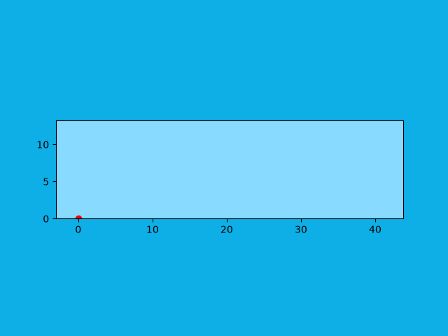

# Projectile Motion Simulation

An animated projectile motion simulation in Python. You enter a launch speed and angle, and the program animates the ball's flight with Matplotlib. This was my first project using `matplotlib.animation`, built to learn how animation works in Matplotlib.



Preview shown for `u = 20 m/s` and `θ = 45°`.

## The Physics

The ball is launched from the ground with speed `u` at angle `θ` above the horizontal. Only gravity acts on it (`g = 9.81 m/s²`, downward). The position at time `t` is:

- x(t) = u cos(θ) · t
- y(t) = u sin(θ) · t − ½ g t²

The program also computes these quantities and uses them to set the plot limits:

- Time of flight: T = 2u sin(θ) / g
- Range: R = u cos(θ) · T
- Maximum height: H = (u sin(θ))² / (2g)

## Method

This version uses the exact analytic solution rather than numerical integration. Each animation frame evaluates x(t) and y(t) directly at `t = frame × dt`, with `dt = 0.02 s`. The animation is built with `matplotlib.animation.FuncAnimation`.

## How to Run

1. Install the dependencies:
```
   pip install numpy matplotlib
```
2. Run the script:
```
   python projectile_motion.py
```
3. Enter the initial velocity (m/s) and the launch angle (degrees) when prompted.

## Limitations

- No air resistance
- Flat ground, with launch from height 0
- Gravity is fixed at 9.81 m/s²
- Only initial speed and angle can be changed

## Future Improvements

- Add interactive sliders for initial velocity and launch angle using `matplotlib.widgets`
- Allow parameters to be changed directly inside the figure instead of the terminal
- Add buttons to pause, reset, and replay the simulation
- Display live values such as time, position, and velocity during the animation

## Development Notes

AI tools were used for documentation refinement, such as structuring and drafting this README, and for guidance on saving the animation as a GIF. The simulation code, physics, and final project decisions were written and reviewed by the author.

## License

[MIT License](LICENSE)